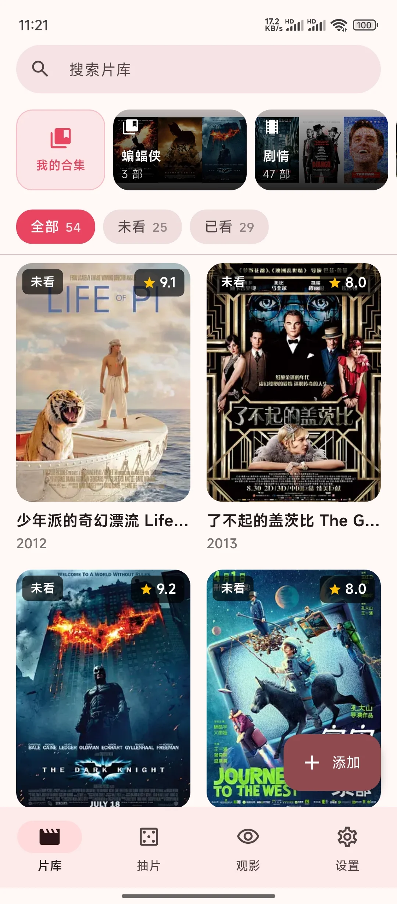
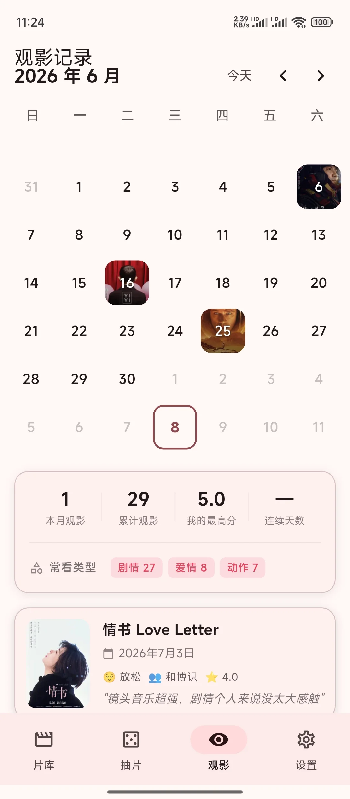
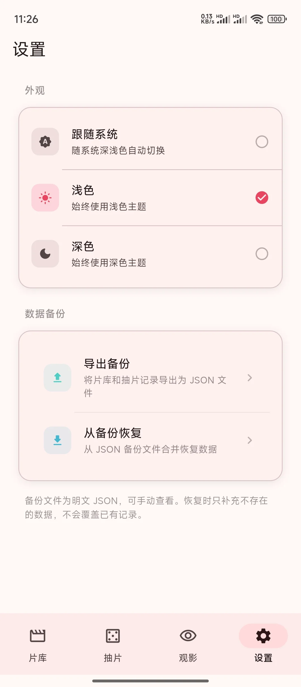
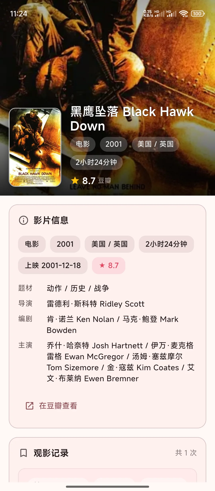
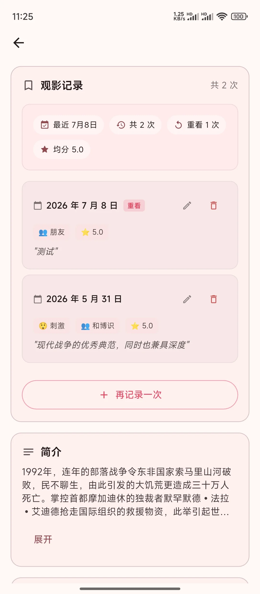
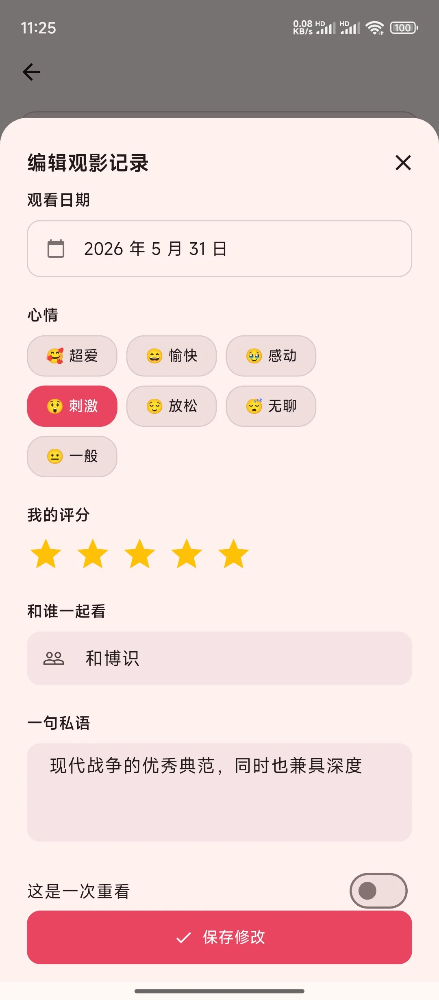
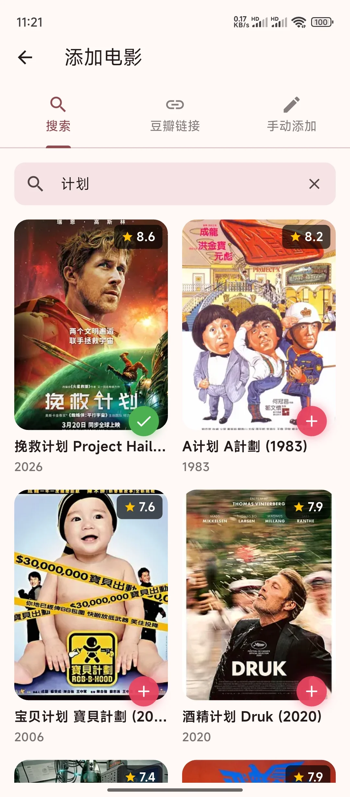
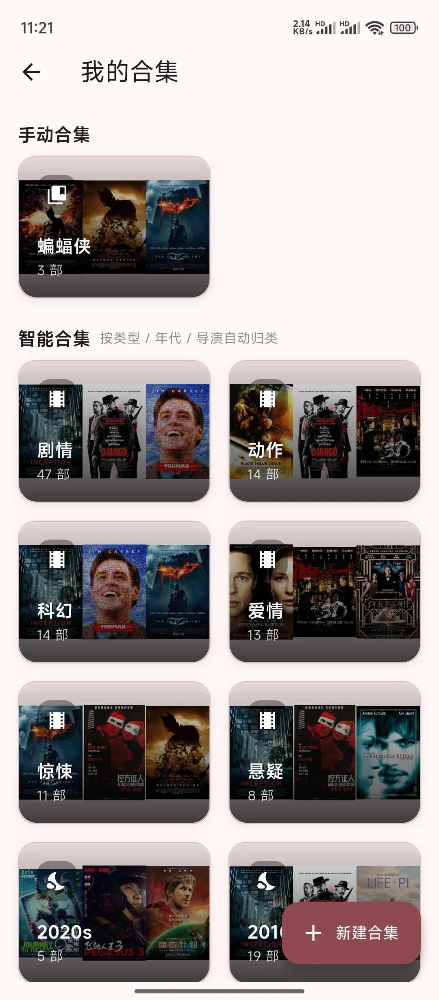
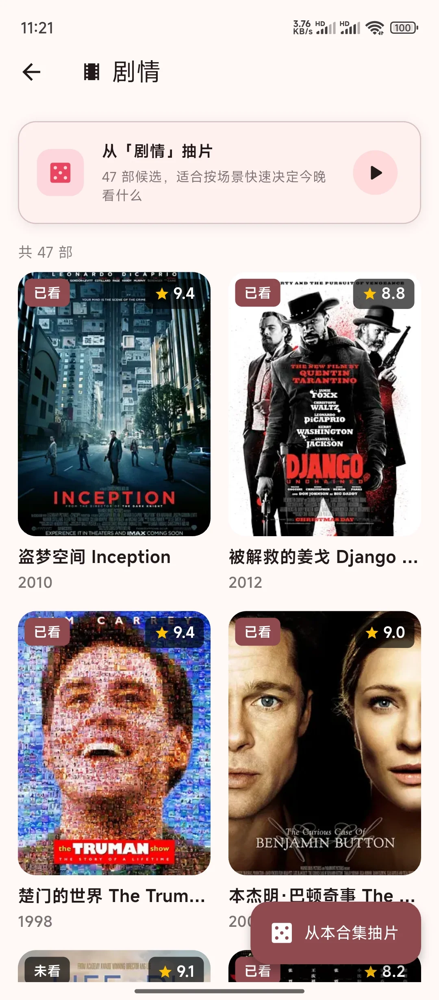
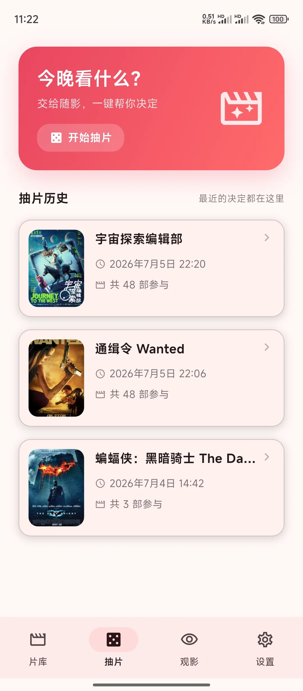

<!-- Updated for the personal UI edition, 2026-11-08. Apache-2.0. -->

## 片刻·焕新版（2026-11-08）

本仓库现已更新为“片刻·焕新版”：保留原片刻的片库、豆瓣导入、观影记录、合集标签、四种抽片、JSON 备份和坚果云同步功能，重新实现统一界面与悬浮底部导航。

- **下载安装**：[焕新版 Release](https://github.com/KUDURO-jw/Pianke-0.2-derivative/releases/tag/v0.2.4-ui.1)，下载 `Pianke-UI-arm64-release.apk`（Android 7.0 及以上，arm64）。同页提供完整源码包和 SHA-256。
- **独立安装**：应用名“片刻·焕新版”，包名 `app.pianke.personal`，版本 `0.2.4 (9)`。与旧版并存；先在旧版导出 JSON，再在新版导入，坚果云应用密码需重新填写。
- **签名和验证**：Release 模式 APK，使用已有 Android Debug 证书签名，不是正式发布证书。静态分析零问题，自动化测试通过；未进行真机或模拟器测试。
- **协议**：UI 独立实现，仅参考 FlClash 的视觉与交互，未复制其 GPL 代码或素材。保留 Apache-2.0、LICENSE、NOTICE 和上游署名。
- **详细资料**：[版本说明](README_UI.md) · [功能对照](docs/FUNCTION_PARITY.md) · [构建说明](docs/BUILD_NOTES.md)。

旧版 Release 仍保留。应用内手动检查更新使用独立的 update-ui.json；旧版 update.json 保持独立。下方保留原项目功能介绍及旧版界面图片；本版界面说明以 README_UI.md 为准。

---

<div align="center">
  
  <h1 align=center>片刻 0.2</h1>

  给每一次观影，留下一点当时的自己。

  <p>
    <strong>多次记录</strong> ·
    <strong>多维感受</strong> ·
    <strong>私人片库</strong> ·
    <strong>随机抽片</strong> ·
    <strong>跨设备备份</strong>
  </p>

  <p>
    <sub>基于 <a href="https://github.com/ShareWinter/Pianke">ShareWinter/Pianke</a> 的二次创作 · Apache License 2.0</sub>
  </p>
</div>

---

## 关于这个仓库

本仓库是 [ShareWinter/Pianke](https://github.com/ShareWinter/Pianke) 的**二次创作（derivative work）**，遵循 Apache License 2.0 分发。

原项目由 ShareWinter 开发，本仓库在原项目基础上修复了抽片状态与已看判定相关问题，并新增了坚果云 WebDAV 跨设备备份。与原项目的主要差异见 [NOTICE](./NOTICE)，其中逐条列出了改动涉及的文件与目的。

本仓库与 ShareWinter 无隶属关系，也未获得其对本次修改的认可。应用名称与 Copyright 2026 ShareWinter 的原始声明均予保留。

如果你想要的是原版，请前往 [ShareWinter/Pianke](https://github.com/ShareWinter/Pianke)。

## 片刻是什么

片刻不是电影社区，也不是豆瓣的替代品。

它更像一本只属于你的观影手帐：同一部影片可以记录很多次，每一次都可以留下日期、同伴、心情、评分和短评；也可以什么都不细填，只用两句话写下「那天看完以后，心里发生了什么」。

有些影片适合认真标注，有些影片只值得随手记一笔。片刻想保留下来的，正是这些很私人的观影瞬间。

## 界面预览

### 主页一览

<table>
  <tr>
    <td align="center"></td>
    <td align="center"></td>
    <td align="center"></td>
  </tr>
  <tr>
    <td align="center">片库</td>
    <td align="center">观影记录</td>
    <td align="center">设置</td>
  </tr>
</table>

### 影片详情与观影记录

影片详情页不只展示影片信息，更重要的是承载每一次观看后的记录。同一部影片可以反复留下不同时间、不同心情、不同同伴下的感受。

<table>
  <tr>
    <td align="center"></td>
    <td align="center"></td>
    <td align="center"></td>
  </tr>
  <tr>
    <td align="center">影片详情</td>
    <td align="center">观影记录</td>
    <td align="center">编辑记录</td>
  </tr>
</table>

### 添加影片

想看的影片可以快速加入片库，之后再慢慢补充观影记录、整理合集，或者等某天抽片抽到它。

添加方式有三种：豆瓣关键词搜索、豆瓣影片／片单链接导入，以及手动填写。

<table>
  <tr>
    <td align="center"></td>
  </tr>
  <tr>
    <td align="center">搜索添加</td>
  </tr>
</table>

### 合集整理

合集适合收纳主题、系列、导演、节日或某种心情。它不是公开片单，而是你给自己的影片分类方式。

<table>
  <tr>
    <td align="center"></td>
    <td align="center"></td>
  </tr>
  <tr>
    <td align="center">我的合集</td>
    <td align="center">合集详情</td>
  </tr>
</table>

### 抽片决定

当片库越来越长，片刻可以从你的收藏里抽出一个今晚的答案。不是替你评分，只是帮你把犹豫变成开始。

<table>
  <tr>
    <td align="center"></td>
    <td align="center"></td>
  </tr>
  <tr>
    <td align="center">抽片首页</td>
    <td align="center">抽片结果</td>
  </tr>
</table>

## 独特之处

| 多次观看 | 多维记录 | 轻量短记 |
| --- | --- | --- |
| 同一部影片可以反复记录，每一次观看都是独立的记忆。 | 日期、评分、心情、同伴、短评一起构成当时的现场感。 | 不想写长评时，只用一两句话记下当时感觉也足够。 |

| 私人片库 | 合集整理 | 抽片决定 |
| --- | --- | --- |
| 收藏真正属于自己的未看、已看和重看清单。 | 按主题、系列、心情或任意灵感整理影片。 | 不知道今晚看什么时，让片刻从你的片库里给出答案。 |

## 使用场景

- 第二次看同一部影片，想知道自己和上一次有什么不同。
- 看完影片没力气写长评，但想留下两句真实的感受。
- 和朋友、恋人、家人一起看过某部片，想把那次场景也记下来。
- 片单越攒越长，想按心情、主题、系列慢慢整理。
- 选择困难时，希望从自己的片库里抽出今晚的答案。

## 多设备备份（本二创版新增）

设置页新增了「坚果云同步」区域，用于在两台设备之间同步片库与观影记录。

**怎么用**

1. 到坚果云网页版生成一个**应用密码**（不是账号登录密码）。
2. 在「设置 → 坚果云同步」里填写坚果云账号、应用密码和远程备份目录，点「测试连接」。
3. 之后可以用「上传备份／从云端恢复／同步」三个按钮手动操作；应用启动和切回前台时也会自动同步一次。

**行为说明**

- 同步内容是片库、观影记录、合集、标签和抽片记录，以及用户名与主题设置。**不包含**坚果云账号和应用密码。
- 每次上传都带 SHA-256 校验值；上传先写临时文件再替换，中途失败不会破坏已有备份。
- 两台设备都改过数据时会弹出冲突提示，由你选择保留本地还是云端，不会静默覆盖。
- 应用密码保存在系统安全存储中（Android Keystore），不会写进备份文件，也不会进入仓库。

## 数据与隐私

片刻默认把影片、观影记录、合集、标签和抽片记录保存在本机。没有注册、没有登录，也不包含统计或广告 SDK。

**只有在你主动开启「坚果云同步」并填写账号后**，应用才会把片库快照上传到你指定的坚果云 WebDAV 目录。该目录由你自己填写，数据只经过你自己的坚果云账号，不经过本项目维护者。不开启同步时，应用不产生任何上传行为。

导出和同步的备份文件都是明文 JSON（便于自行检查与迁移），请把它们存放在你信任的位置。

## 构建

```bash
flutter pub get
flutter build apk --release --split-per-abi
```

需要 Flutter SDK 3.10.7 或更高版本。发布前请自行配置签名（当前 `android/app/build.gradle.kts` 仍使用 debug 签名，仅供本地运行）。

## License

本项目基于 [ShareWinter/Pianke](https://github.com/ShareWinter/Pianke) 二次创作，遵循 [Apache License 2.0](./LICENSE) 分发。

```
Copyright 2026 ShareWinter      （原始项目）
Copyright 2026 KUDURO-jw        （二次创作部分，详见 NOTICE）
```

使用、修改或再分发时，请保留上述两行版权声明与 [LICENSE](./LICENSE) 全文，并按 Apache 2.0 第 4 条在修改过的文件中保留声明。
